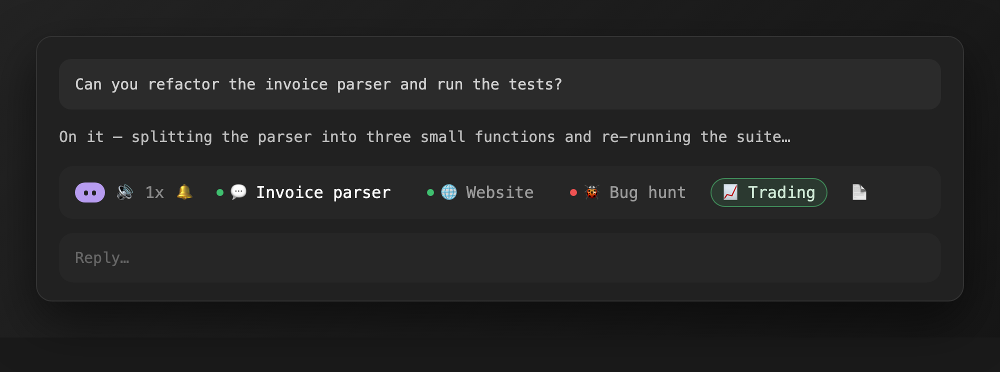
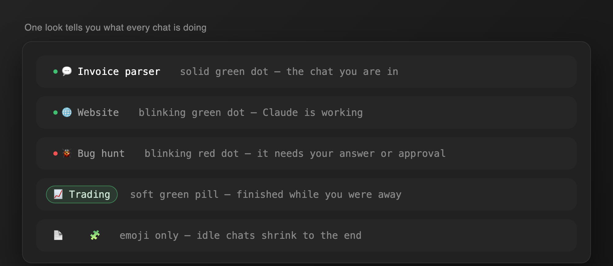
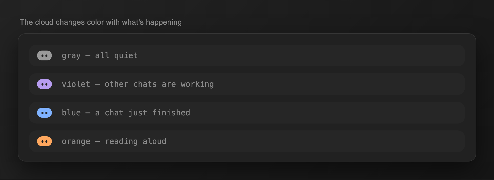
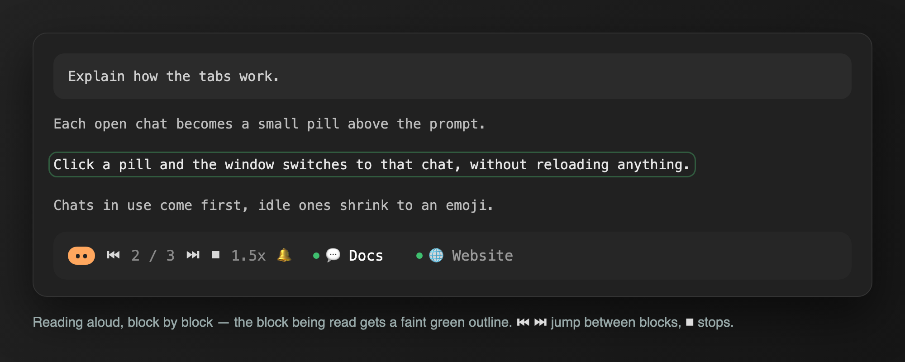

<h1 align="center">☁️ GG</h1>

<p align="center">
  <b>A little cloud above the Claude desktop prompt.</b><br>
  Your open chats one click away · a chime when one finishes · a red dot when one needs you · read-aloud with your Mac's own voices.
</p>

<p align="center">
  <a href="LICENSE"></a>
  
  
  
  
</p>

<p align="center">
  
</p>

<p align="center"><i>
Una nubecita que vive arriba del renglón de Claude: tus chats abiertos a un clic, un aviso suave cuando uno termina,
un puntito rojo cuando uno te necesita, y lectura en voz alta con las voces de la Mac. Sin internet ni tokens.
</i></p>

---

## Why

Running several Claude chats at once means constant window-hopping: *did that one finish? is another one waiting for me to approve something?* GG puts the answer in one small bar, right where you are already looking — above the prompt.

- 🗂️ **Tabs for your chats** — one pill per open chat, one click to switch.
- 🔴 **Know who needs you** — a blinking red dot means Claude is waiting for your answer or approval.
- ✅ **Know who's done** — a soft green pill and a gentle chime when a chat finishes while you were elsewhere.
- 🔊 **Read aloud** — Claude's answer, block by block, with a faint outline on the block being read.
- 🆓 **Free and local** — no internet, no API keys, no tokens.

## Quick start

In the Claude app (or `claude` in a terminal):

```
/plugin marketplace add geovaniegalvan27-svg/gg
/plugin install gg@gg
```

Start a new chat (or restart the open ones). That's it — the cloud appears above the prompt.
`/gg` shows or hides the bar.

> Requires macOS and the Claude desktop app's **Code** tab.

## How to read the bar

```
 (••)  🔊  1x  🔔   • 💬 Invoice parser   • 🌐 Website   • 🐞 Bug hunt   (📈 Trading)   📄
```

| Piece | What it is |
|---|---|
| **(••)** the cloud | Breathes. Its color tells you the overall mood (see below). |
| **🔊** | Read the answer aloud. Becomes **⏮ 2/7 ⏭ ⏹** while reading. |
| **1x** | Reading speed. Click to cycle 1x · 1.5x · 2x. |
| **🔔** | Chime on/off. The bell swings when a chat finishes. |
| **Pills** | One per open chat. Click to jump to it. |

### What every chat is doing

<p align="center">
  
</p>

- **Solid green dot** — the chat you are in.
- **Blinking green dot** — Claude is working there.
- **Blinking red dot** — it needs you: a question, or an approval to give.
- **Soft green pill** — it finished while you were looking elsewhere (and the chime played once).
- **Emoji only** — idle chats shrink to the end of the bar so the ones in use keep their names.

Each chat gets a topic emoji and a short name taken from its title. A title written as `Topic · what it is`
uses the part before the `·` as the tab name.

### What the cloud says

<p align="center">
  
</p>

## Read aloud, block by block

Press **🔊** (or type `/leer`) and GG reads everything Claude wrote since your last message, from the top, one text block after another.

<p align="center">
  
</p>

- The block being read gets a faint green outline in the chat.
- **⏮ ⏭** repeat the previous block or skip ahead. **⏹** stops.
- The speed button cycles 1x · 1.5x · 2x.
- It only reads when you ask — never on its own.

### Nicer voices (free)

GG picks the best installed voice for your language: **Premium**, then **Enhanced**, then any (or the one set as `voz` in the settings).
The voices macOS ships by default sound robotic; the good ones are a free download:

**System Settings → Accessibility → Spoken Content → System voice → Manage Voices…**
Pick your language and download a voice marked *Premium* or *Enhanced* (for Spanish: *Paulina*, *Mónica*, *Marisol*). GG uses it on the next chat.

Want even more natural? Point GG at a local [Kokoro](https://github.com/hexgrad/kokoro) server (see `kokoro` below).

## Settings (optional)

Create `~/.claude/gg.json`:

```json
{
  "idioma": "es",
  "voz": "Paulina (Premium)",
  "temas": [
    { "buscar": "invoice|factura", "emoji": "🧾", "nombre": "Facturas" },
    { "buscar": "\\bblog\\b", "emoji": "✍️", "nombre": "Blog" }
  ]
}
```

| Key | What it does |
|---|---|
| `idioma` | Language code used to pick a voice (`es`, `en`, `pt`…). Default `es`. |
| `voz` | Exact voice name from `say -v '?'`, to skip the automatic pick. |
| `kokoro` | URL of a local [Kokoro](https://github.com/hexgrad/kokoro) TTS server with a `POST /wav` endpoint. When it answers, its natural voices are used and the whole reading is prepared ahead so it flows. Set `voz` to `Kokoro · Dora (mujer)`, `Kokoro · Alex (hombre)` or `Kokoro · Santa (hombre)`. |
| `temas` | Your own topics, checked before the built-in ones. `buscar` is a regular expression matched against the chat title. |

## How it works

GG is a Claude Code mod (a hooks module). It runs with your user's permissions, and this is everything it touches:

- **Reads** the desktop app's own session list under `~/Library/Application Support/Claude/` to know which chats are open, working, finished or waiting for you, and `~/.claude/gg.json` for your settings.
- **Writes** only `~/.claude/gg.json`, to remember the voice you picked.
- **Switches chats** with the app's `claude://code/continue?session=…` link — no reload.
- **Speaks** with macOS's `/usr/bin/say`, or your own local Kokoro server if you configure one.
- **⧉ button** uses one AppleScript (`bin/ventanas.sh`) to read the names of Claude's windows and move the popped-out one; macOS asks for Accessibility permission the first time.
- **Network:** none, except `127.0.0.1` for your own Kokoro server if you set it up.

The whole thing is a few small files — read them before you install.

## Contributing

Issues and pull requests are welcome. If GG saved you a few window-hops, a ⭐ helps others find it.

## License

[MIT](LICENSE)
